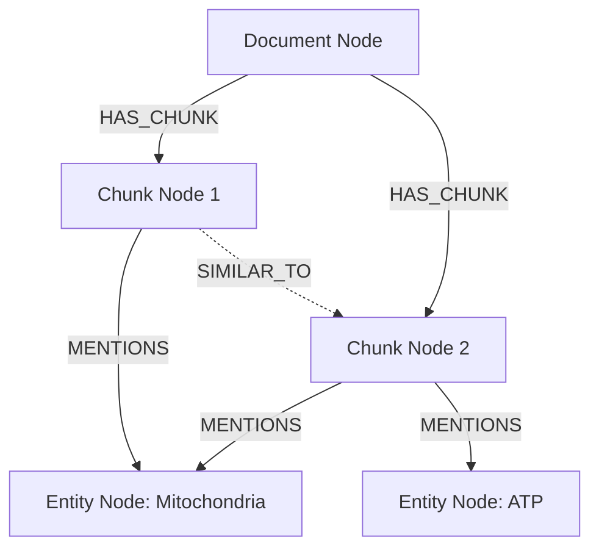

# Data Model: Evaluation, Knowledge Graph & Observability Entities

This document defines the formal data schemas, relational models, graph ontologies, and telemetry structures supporting Stage 10 (Evaluation, Observability & Guardrails) and Stage 4/10 (Knowledge Graph).

---

## 1. Evaluation Entities

### 1.1 Golden Benchmark Item (`golden_set.jsonl`)

The Golden Benchmark Dataset format used by `rag_core.evaluation.load_dataset`:

```json
{
  "id": "faq_hr_014",
  "suite": "admin_faq",
  "question": "What is the procedure for requesting remote work approval?",
  "ground_truth": "Submit a remote work request form via the HR portal at least 5 business days in advance with manager sign-off.",
  "domain": "administrative_faq",
  "evolution_type": "colloquial_mutation",
  "metadata": {
    "category": "leave_and_attendance",
    "target_documents": ["hr_handbook_2026.pdf"],
    "difficulty": "medium",
    "multi_hop": false
  }
}
```

| Field | Type | Description |
|---|---|---|
| `id` | `str` | Unique identifier formatted by suite prefix and sequence number |
| `suite` | `str` | Evaluation suite identifier: `science`, `admin_faq`, `domain_routing`, or `adversarial_refusal` |
| `question` | `str` | User query input (may include colloquial or perturbed phrasing) |
| `ground_truth` | `str` | Reference answer for faithfulness and precision calculation |
| `domain` | `str` | Expected domain routing classification |
| `evolution_type` | `str` | Evol-Instruct mutation tag: `simple`, `reasoning`, `multi_hop`, `colloquial_mutation`, `adversarial` |
| `metadata` | `dict` | Contextual tags including target document filenames, category, and complexity flags |

---

### 1.2 Layer 1 Gate Result (`GateResult`)

Returned by deterministic code evaluation gates (`rag_core.evaluation.code_gates`):

```python
class GateResult:
    passed: bool
    reason: str
    matched_rule: str | None
    latency_seconds: float
```

- **Execution Guarantee**: `< 5ms` execution time, zero LLM tokens consumed.
- **Rule Triggers**:
  - `persian_refusal_patterns`: Regex match on polite refusal statements when context is absent or query is out-of-scope.
  - `domain_routing_lexicon`: Keyword/jargon membership matching query terms to document namespaces.

---

### 1.3 Layer 2 Judge Verdict (`JudgeVerdict`)

Returned by LLM-as-a-Judge evaluations (`rag_core.evaluation.judge_evaluator`):

```python
class JudgeVerdict:
    reasoning: str
    score: float
    verdict: str  # "CORRECT", "INCORRECT", "REFUSAL_ACCEPTED", "DOMAIN_MATCH"
    raw_response: str
    latency_seconds: float
```

- **Latency Attribution**: `latency_seconds` tracks the wall-clock execution duration of the judge LLM call via `time.perf_counter()`.
- **Reasoning Protocol**: Evaluates using a 5-step Chain-of-Thought (CoT) rubric before returning the final discrete score.

---

### 1.4 Ragas Evaluation Adapter Metrics (`RagasMetricsResult`)

Calculated by `rag_core.evaluation.ragas_adapter.LocalRagasEvaluator`:

```python
class RagasMetricsResult:
    faithfulness: float
    answer_relevancy: float
    context_precision: float
    context_recall: float
    latency_seconds: float
    evaluation_metadata: dict
```

- **Target Thresholds**:
  - `Faithfulness >= 0.80`
  - `Answer Relevancy >= 0.75`
  - `Context Precision >= 0.75`
  - `Context Recall >= 0.70`

### 1.5 Layer 2.5 Jev System One Evaluation & Routing Models

Returned by `rag_core.evaluation.jev_judge.JevJudge` and `rag_core.query.jev_router.JevRouter`:

```python
@dataclass
class JevEvaluationResult:
    faithfulness_noul: float          # Calibrated probability (0.0 to 1.0)
    faithfulness_passed: bool         # True if noul >= 0.80
    relevancy_score: float            # Continuous expected score (0.0 to 2.0)
    relevancy_level: int              # Discrete winning level: 0 (Evasive), 1 (Partial), 2 (Complete)
    relevancy_passed: bool            # True if score >= 1.50
    refusal_noul: Optional[float]     # Calibrated probability (0.0 to 1.0) for adversarial queries
    refusal_passed: Optional[bool]    # True if refusal_noul >= 0.70
    confidence: float                 # TypeSafe distribution confidence (0.0 to 1.0)
    latency_seconds: float            # Single-request roundtrip duration (< 0.5s)
    fallback_invoked: bool            # True if fallen back to local LLMJudge

@dataclass
class JevRoutingResult:
    domain: str                       # Winning route: "science_textbook", "administrative_faq", "out_of_scope"
    probabilities: Dict[str, float]   # Probability distribution across all options
    confidence: float                 # Certainty of selected domain
    latency_seconds: float            # Decision duration (< 0.3s)
    fallback_invoked: bool            # True if fallen back to local router
```

---

## 2. Neo4j Knowledge Graph Data Model

The graph store is managed by `rag_core.kg.neo4j_store.Neo4jKnowledgeGraph` and deployed in Docker container `neo4j-rag`.

### 2.1 Graph Schema Overview



### 2.2 Node Labels & Properties

#### `(:Document)`
- `doc_id` (`STRING`, UNIQUE): Unique document identifier.
- `filename` (`STRING`): Original document filename.
- `sha256` (`STRING`): Hash of document content for deduplication.
- `created_at` (`STRING`): ISO-8601 creation timestamp.

#### `(:Chunk)`
- `chunk_id` (`STRING`, UNIQUE): Deterministic chunk identifier (e.g., `doc_sha_c001`).
- `text` (`STRING`): Chunk textual content.
- `page` (`INTEGER`): Source page number.
- `chunk_index` (`INTEGER`): Sequence index within parent document.
- `embedding` (`LIST<FLOAT>`, Optional): Vector embedding representation.

#### `(:Entity)`
- `name` (`STRING`): Canonicalized entity name.
- `type` (`STRING`): Entity category (e.g., `CONCEPT`, `ORGANIZATION`, `BIOLOGY_TERM`, `REGULATION`).
- `domain` (`STRING`): Target domain namespace.

#### `(:Keyphrase)`
- `phrase` (`STRING`): Extracted keyphrase.

### 2.3 Relationships

| Relationship | Source | Target | Properties | Purpose |
|---|---|---|---|---|
| `HAS_CHUNK` | `Document` | `Chunk` | `order: INTEGER` | Document structural hierarchy |
| `MENTIONS` | `Chunk` | `Entity` | `confidence: FLOAT` | Semantic entity attribution |
| `SIMILAR_TO` | `Chunk` | `Chunk` | `score: FLOAT` | Cosine similarity between chunk vectors |

### 2.4 Multi-Hop Discovery Cypher Query

Used for identifying candidates across disparate chunks connected via common entity bridges:

```cypher
MATCH (c1:Chunk)-[:MENTIONS]->(e:Entity)<-[:MENTIONS]-(c2:Chunk)
WHERE c1 <> c2 AND NOT (c1)-[:HAS_CHUNK]-(:Document)-[:HAS_CHUNK]-(c2)
RETURN c1.chunk_id AS chunk_a,
       c2.chunk_id AS chunk_b,
       e.name AS shared_entity,
       c1.text AS text_a,
       c2.text AS text_b
LIMIT 20;
```

---

## 3. Observability & Tracing Data Model (Langfuse & OpenInference)

Implemented in `rag_core.observability.langfuse.LangfuseTracker` wrapping OpenTelemetry / OpenInference standards according to Constitution v1.2.0:

### 3.1 Trace Structure

- **Trace Name**: `unified_rag_query` | `unified_rag_eval`
- **Session ID**: User session or evaluation run identifier (e.g., `eval-run-20261004-01`)
- **User ID**: Optional tenant / user identifier for auditability
- **Release Version**: Project release tag (e.g., `v1.2.0`)
- **Tags**: `["stage:naive", "suite:science_textbook", "env:development"]`
- **Metadata**:
  - `model`: Embedding and generation model identifiers
  - `retriever_type`: `qdrant` | `numpy` | `hybrid`
  - `environment`: `development` | `staging` | `production`
  - `eval_suite`: Associated suite name if running benchmark

### 3.2 Span & Generation Hierarchy

```text
Trace: unified_rag_query
├── Span: parsing
│   ├── Input: file_path, document_type
│   ├── Output: block count, canonical IR metadata
│   └── Attributes: latency_seconds, parser_engine: "pymupdf"
│
├── Span: chunking
│   ├── Input: canonical blocks, strategy: "fixed" | "hierarchical"
│   ├── Output: chunk count, token count distribution
│   └── Attributes: latency_seconds
│
├── Span: embedding
│   ├── Input: text chunk list
│   ├── Output: embedding vector dimensions (1024-d)
│   └── Attributes: model: "bge-m3", batch_size, latency_seconds
│
├── Span: retrieval
│   ├── Input: query string, top_k, filter criteria
│   ├── Output: retrieved chunk IDs, source documents, cosine similarity scores
│   └── Attributes: latency_seconds, vector_db: "qdrant"
│
└── Generation: synthesis
    ├── Input: system prompt, formatted context, user query
    ├── Output: synthesized response string with page citations
    ├── Model: "gemini-cli" / "gpt-4o" / "llama-3.1"
    └── Usage & Attributes:
        ├── prompt_tokens: INTEGER
        ├── completion_tokens: INTEGER
        ├── total_tokens: INTEGER
        ├── total_cost_usd: FLOAT
        └── latency_seconds: FLOAT
```

### 3.3 Evaluation Trace Scores (`trace.score()`)

When running automated benchmarks or LLM-as-a-Judge evaluations, verdicts are ingested directly into Langfuse as numerical scores linked to the trace ID:

| Score Name | Data Type | Range | Source | Purpose |
|---|---|---|---|---|
| `gate_pass` | `INTEGER` | `0` or `1` | Layer 1 Deterministic Code Gate | Instant refusal / routing gate filter |
| `faithfulness` | `FLOAT` | `[0.0, 1.0]` | Layer 2 LLM Judge / Ragas | Groundedness score (zero hallucination) |
| `answer_relevancy` | `FLOAT` | `[0.0, 1.0]` | Layer 2 LLM Judge / Ragas | Semantic pertinence to query |
| `context_precision`| `FLOAT` | `[0.0, 1.0]` | Ragas Metric Adapter | Retrieval ranking accuracy |
| `context_recall`   | `FLOAT` | `[0.0, 1.0]` | Ragas Metric Adapter | Ground truth coverage |
| `judge_latency`    | `FLOAT` | `seconds` | Layer 2 Judge Timer | Performance & timeout tracking |

---

## 4. Manifest Catalog & Cascade Deletion Data Model

The manifest catalog is persisted in PostgreSQL to track document provenance, exact duplicates, and deletion transactions.

### 4.1 Manifest Catalog Table (`manifest_documents`)

```sql
CREATE TABLE manifest_documents (
    doc_id VARCHAR(64) PRIMARY KEY,
    filename VARCHAR(255) NOT NULL,
    sha256_hash CHAR(64) NOT NULL UNIQUE,
    minhash_signature BYTEA,
    tenant_id VARCHAR(64) NOT NULL DEFAULT 'default',
    acl_roles TEXT[] NOT NULL DEFAULT '{"public"}',
    status VARCHAR(32) NOT NULL DEFAULT 'active', -- 'active', 'parsing', 'indexed', 'failed'
    mime_type VARCHAR(64) NOT NULL,
    page_count INTEGER DEFAULT 0,
    total_chunks INTEGER DEFAULT 0,
    created_at TIMESTAMP WITH TIME ZONE DEFAULT CURRENT_TIMESTAMP,
    updated_at TIMESTAMP WITH TIME ZONE DEFAULT CURRENT_TIMESTAMP
);

CREATE INDEX idx_manifest_sha256 ON manifest_documents(sha256_hash);
CREATE INDEX idx_manifest_tenant_status ON manifest_documents(tenant_id, status);
```

### 4.2 Synchronous Cascade Deletion Protocol

When a document deletion is requested via `doc_id`:
1. **Transaction Begin**: Open database transaction.
2. **Qdrant Vector Purge**: Execute synchronous delete filter: `Filter(must=[FieldCondition(key="doc_id", match=MatchValue(value=doc_id))])`.
3. **BM25 Inverted Index Purge**: Remove all posting entries associated with `doc_id`.
4. **Neo4j Subgraph Purge**: Execute Cypher query:
   ```cypher
   MATCH (d:Document {doc_id: $doc_id})
   OPTIONAL MATCH (d)-[:HAS_CHUNK]->(c:Chunk)
   DETACH DELETE c, d;
   ```
5. **Postgres Manifest Row Delete**: `DELETE FROM manifest_documents WHERE doc_id = $doc_id;`
6. **Commit or Rollback**: If any secondary store fails, abort transaction and raise `CascadeDeletionError`.

---

## 5. Chunk Hierarchy Data Model (Stage 3)

### 5.1 Retrieval Chunk Dataclass (`Chunk`)

```python
@dataclass
class Chunk:
    chunk_id: str               # Deterministic: f"{doc_id}_c{chunk_index:04d}"
    doc_id: str                 # Stable parent doc_id
    parent_id: str | None       # Enclosing section / parent chunk ID
    text: str                   # Cleaned chunk text with breadcrumb prefix
    normalized_text: str        # Hazm/Parsivar normalized text for BM25 matching
    breadcrumb: str             # "Doc > Chapter > Section (page N)"
    page: int                   # First block page
    token_count: int            # Target: ~512 tokens (ceiling 1024 for cohesive semantic sections)
    is_parent: bool             # False for atomic retrieval chunks; True for aggregated parent
    child_chunk_ids: list[str]  # Populated for parent chunks (aggregating N children)
    metadata: dict              # Preserved block types, tables, bboxes
```

### 5.2 Structured Refusal Payload Model (`RefusalResult`)

```python
@dataclass
class RefusalResult:
    is_refusal: bool
    refusal_reason: str         # "OUT_OF_SCOPE", "PROMPT_INJECTION", "UNANSWERABLE", "UNSUPPORTED_LANGUAGE"
    refusal_category: str       # Golden benchmark category tag
    message: str                # Standardized Persian refusal statement
    latency_seconds: float      # Sub-millisecond execution duration
    source_gate: str            # "layer1_code_gate" or "layer2_llm_judge"
```

